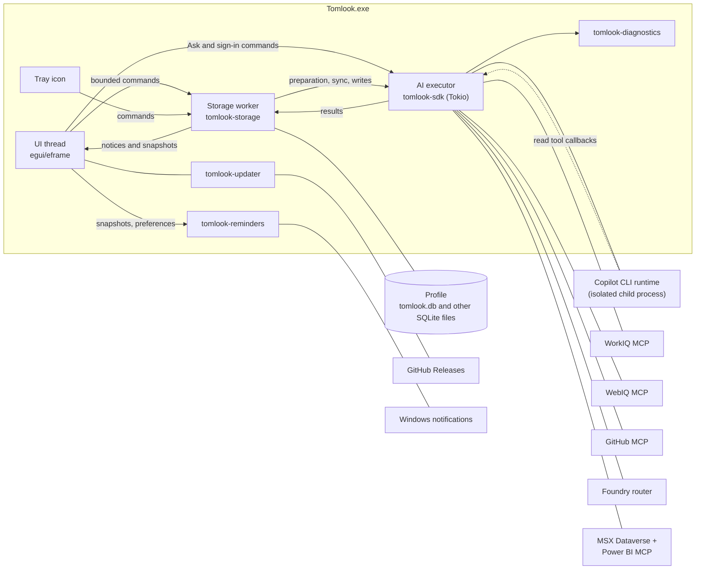

# Architecture

Tomlook is one Rust crate in [`native\`](native/) that builds a native
Windows executable with [egui/eframe](https://github.com/emilk/egui)
(OpenGL, AccessKit). There is no browser, WebView, server or Python/Node
bridge. AI runs through the official Rust GitHub Copilot SDK, which drives an
installed Copilot CLI runtime as a child process.

## Components and threads

| Thread | Owns |
|---|---|
| UI (main) | Navigation, filters and rendering of immutable snapshots (`Arc<Calendar>`, activity snapshots). No disk or network I/O. |
| `tomlook-preload` | Opens SQLite and loads the cached calendar while the window and OpenGL start; hands the store to the storage worker. |
| `tomlook-storage` | The only user of `tomlook.db`: imports, calendar sync planning and persistence, per-day layout, preparation queue, recommendations, approvals and outcomes, tasks, customers, demo data, PNG export. |
| `tomlook-sdk` | A Tokio runtime (two workers) with the Copilot SDK harness, WorkIQ, WebIQ, GitHub, Foundry and MSX clients, read tools, calendar/Teams writers and AI accounting. |
| `tomlook-reminders` | Meeting reminders, morning and weekly notifications, AppUserModelID registration and toast activation. |
| `tomlook-updater` | Daily release checks, signature/hash verification, staging and install-on-exit. |
| `tomlook-diagnostics` | Writes rotating `diagnostics.jsonl`. |
| `tomlook-window-restore` | Waits on a profile-scoped Windows event so a second launch restores the existing window. |
| `tomlook-setup-probe` | One-shot lookup of Azure CLI, the configured Copilot runtime and saved sign-ins for the setup checklist. |

### Rules

- **No I/O on the UI thread.** The UI sends commands and paints the latest
  snapshot; workers request a repaint when something changes. There is no
  idle polling loop.
- **Bounded channels everywhere** (storage 64, AI executor 64, smaller result
  channels). Notices are coalesced so a hidden window cannot block a worker.
- **Revisions guard staleness.** Detail requests, Ask contexts, preparation
  results and sync batches carry a revision or connection generation; late
  results for an old meeting, account or connection are discarded.
- **Shutdown** (Exit, tray, Ctrl+Shift+Q) stops the AI executor first with a
  priority signal, drains approved writes and ready results into storage,
  then stops storage, reminders and the updater outside UI callbacks.
- **One instance per profile** via an exclusive lock file; a second launch
  only signals the first one to show its window.

## Module map (`native\src`)

| Area | Modules |
|---|---|
| Entry and lifecycle | `main.rs` (arguments, eframe, shutdown), `instance.rs`, `tray.rs`, `brand.rs` |
| UI | `app\` (`calendar`, `meeting`, `event_editor`, `find_time`, `invitations`, `ask_panel`, `recommendations`, `settings`, `setup`, `myday`, `weekly`, `tasks`, `followup`, `feedback`, `customers`, `connections`, `palette`), `i18n.rs` (EN/CZ catalog), `markdown.rs`, `browser.rs` (safe URL and `mailto:` opener) |
| Storage and scheduling | `worker.rs` (storage worker) + `worker\invitations.rs`, `storage.rs` (schema, preferences, legacy import), `calendar.rs` (events, layout, filters), `calendar_sync.rs`, `scheduler.rs` (preparation queue, fingerprints), `search.rs` (fuzzy keyword index), `retry.rs`, `telemetry.rs`, `fixture_cache.rs`, `showcase.rs` (offline demo), `interaction_trace.rs` |
| AI | `ai.rs` (executor), `copilot.rs` (isolated SDK harness, sessions, tool registry), `chat.rs` (Ask modes, durable research), `chat_cache.rs` (calendar/Insights read tools), `ask.rs` (slash commands), `context.rs` and `source_index.rs` (local documents), `evidence.rs` (tool evidence, citation binding, redaction), `decision.rs` (Foundry router), `prompts.rs`, `changes.rs` and `proposals.rs` (AI-proposed edits), `recommendations.rs`, `recaps.rs` (post-meeting notes) |
| Features | `invitations.rs` (account-owned queue, local priorities, team cache), `myday.rs`, `weekly.rs`, `tasks.rs`, `followup.rs`, `feedback.rs`, `customers.rs` + `customers\`, `attendees.rs`, `availability.rs`, `scheduling.rs` (Find a time, BLOCKERs), `event_creation.rs`, `company.rs` (icons), `setup.rs`, `reminders.rs`, `updater.rs` |
| Connectors | `workiq.rs` + `workiq\` (`hosted` sign-in, `connection` reads, `vault`, `invitations`, `calendar_write`, `chat_write`, `cloud`, `meeting_notes`), `connectors.rs` (WebIQ, GitHub), `credentials.rs` (DPAPI), `msx.rs` + `msx\` (`auth`, `mcp`, `dataverse`, `acr`, `tools`), `azure_cli.rs` |
| Tools | `bin\` probes and `release-sign` (see [development.md](docs/development.md#probes-and-diagnostics)) |

## Data model highlights

- **Profile** (`%LOCALAPPDATA%\Tomlook`): `tomlook.db` (all product state),
  `ai-usage.db`, `ask-research.db`, `source-index.db`, DPAPI vaults
  `workiq-login.db` and `connector-login.db`, `connections.json`,
  `decision-router.json`, the isolated `copilot\` home. Details:
  [privacy-and-safety.md](docs/privacy-and-safety.md#what-is-stored-locally).
- **Calendar cache** is owned by one account (the calendar owner's e-mail).
  Each event keeps bounded Graph metadata (`id`, `iCalUId`, subject, times,
  categories, attendees up to 500 with the full count and a list fingerprint,
  organizer, response, `showAs`, `type`, nonempty `seriesMasterId`, sensitivity, online meeting fields,
  `webLink`, `bodyPreview`). Coverage is stored per day with its last
  successful refresh; a day without coverage is "Not synced", never free.
- **Insights** are versioned bilingual documents (English narrative plus a
  nested `cs` narrative with identical structure) with sources and captured
  tool evidence. Notes use a separate ledger (`meeting-recaps-v1`) with an
  atomic processed marker per occurrence.
- **Approvals and outcomes** (event creations, existing-event changes,
  recommendations, proposals) are durable records bound to account, event
  occurrence and fingerprint; settings keys such as
  `meeting-reminders-fired-v1` record once-only notifications.
  Ask's `tomlook_propose_meeting_change` stages both creation and removal
  proposals, never provider writes. New events use the existing creation
  ledger in `Pending` state; only the UI's exact approval consumes it into
  `Creating`. Existing-event removals use the recommendation ledger and
  organizer-aware delete/cancel/decline actions. Both flows reuse the typed
  WorkIQ writers and read-back verification; chat has no approval tool.

## Calendar synchronization

After WorkIQ connects, the storage worker plans reads from one month back to
six months ahead, visible days first, in windows of at most 42 days (at most
128 requests, 5,000 events and 16 MiB per operation, two-minute deadline).
WorkIQ blocks Graph paging tokens, so oversized ranges are split. A complete,
account-verified batch replaces the cached days atomically; incomplete or
inconsistent responses are refused and the previous cache is kept. Days within
two weeks refresh every 15 minutes, others every six hours, with exponential
backoff on failure. One WorkIQ read slot is reserved for the calendar so
research cannot starve it.

## Invitation reads and local priority

The invitation worker independently schedules response-filtered `calendarView`
reads over six months every 180 seconds, using the existing bounded
time-partitioning reader and a separate WorkIQ read semaphore. These reads
produce **no calendar coverage** and never use the full-calendar replacement
path. Membership reads refresh enabled directory groups daily; explicit
historical-mail discovery samples recipient headers and returns disabled
candidates. Incomplete membership is refused, not mislabeled as complete.

The executor does not require an AI model for these typed reads. Request IDs,
account binding and connection generations guard results; deadlines and
backoff retain the old cache on failure. Mutations use clone/validate/persist
before publication in an account-hashed `invitation-inbox-v1` settings entry.
Verified calendar responses/removals update the book immediately and invalidate
older queue reads so they cannot restore resolved requests.

Pure local classification reuses user-confirmed customer domains and explicit
team/organizer/series choices. External-domain evidence remains unconfirmed.
The UI focuses a staged cached occurrence and temporarily overrides display
filters; it reuses the ordinary RSVP/category approval and writer without
adding another approval surface. Series are collapsed for browsing, never
promoted to whole-series write authority.

## Preparation scheduler and fingerprints

`scheduler.rs` keeps a versioned queue in `tomlook.db` (64 pending jobs, two
execution slots, at most one background job; overflow is deferred, not
dropped). Eligible meetings are accepted or organized, not cancelled, not
BLOCKERs, not followed, ending in the future and starting within six months.
The opened meeting and **Research now** take priority; automatic work starts
nearest first.

Each job stores a **fingerprint**: SHA-256 over the analysis revision and the
event's JSON, excluding the preparation status and local-only fields
(`bodyPreview`). The analysis revision is a digest of the model, static
configuration, prompt policy, Copilot runtime identity and the connected
WebIQ/GitHub identities. A result is published only if the fingerprint still
matches; a changed meeting or configuration invalidates old results and
expires related proposals. Because `bodyPreview` is excluded (and stripped
from AI input), synchronizing invitation previews never re-prepares meetings
or invalidates approvals. Customer context is appended to the prompt at
dispatch time and is not part of the fingerprint either.

Validated results and the completed ledger entry are written in one
transaction with read-back. Automatic failures retry up to three times with
backoff; manual failures wait for an explicit retry. Insights within 14 days
are refreshed after 24 hours. Upcoming preparation and transcript checks
alternate in one background lane, so interactive questions always keep a slot.
A daily request budget (`ai-usage.db`) is admitted before any session starts.

## Write pipeline

All writes go through native code, never through model tools:

1. The UI (or **Approve change**) sends the exact operation to the storage
   worker, which saves it as a single-use approval bound to the account,
   occurrence and fingerprint, and consumes it transactionally.
2. The AI executor's WorkIQ writer (`workiq\calendar_write.rs`,
   `workiq\chat_write.rs`) checks the provider schema, refetches the event
   and compares its fingerprint, rechecks free time where relevant, submits
   once with a stable transaction ID and reads the result back.
3. The outcome (verified, rejected, or uncertain) is persisted and shown in
   Messages. Uncertain outcomes are never replayed; **Check calendar result**
   only re-reads. Reads use the reserved calendar lane.

Local document edits (approved Insights/notes sections) are applied by the
storage worker in one SQLite transaction together with consuming the approval.
See [privacy-and-safety.md](docs/privacy-and-safety.md#writes-and-approvals).

## Update pipeline

`updater.rs` runs on its own thread: GitHub Releases API → download
`tomlook-update.json` and `.sig` → verify Ed25519 against `TRUSTED_KEYS` →
parse and validate the manifest → stream the ZIP to a staging file with size
and SHA-256 checks → extract only the three allowed entries → verify the
executable hash → stage in `.tomlook-update\<version>\`. **Restart now** (or a
normal exit) renames the running exe to `Tomlook.exe.old`, installs the staged
one with rollback on failure and starts it with `--after-update <pid>`, which
waits for the old process before taking the profile lock. Releases are
produced by `scripts\package-release.ps1`
([development.md](docs/development.md#releasing)).

## Startup

The cached calendar is read on `tomlook-preload` in parallel with window and
OpenGL creation, so the first frame shows the cached calendar. Copilot is
started lazily (at startup only with a saved isolated sign-in, never with a
browser), and opening the calendar or Ask never waits for AI.
