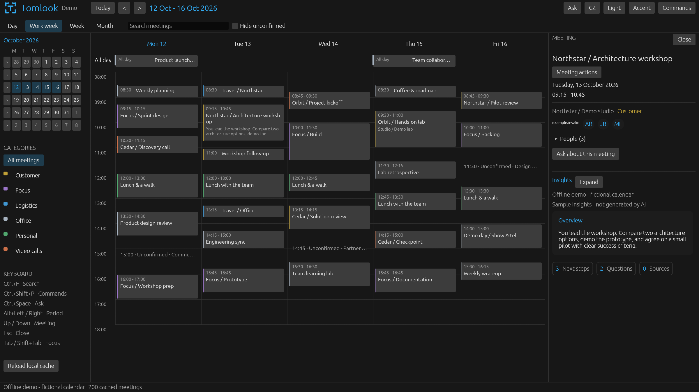

# Tomlook

Tomlook is a performance-first, native Windows calendar with an asynchronous AI
assistant and meeting Insights. It reads Microsoft 365 data through remote MCP
servers, keeps the calendar responsive, and supports English and Czech,
light/dark themes, and a configurable accent.

Production never seeds or falls back to synthetic meetings. An explicit,
isolated **offline demo** is available for trying the interface and taking
privacy-safe screenshots.

## Preview



*Actual native application, using only fictional meetings, contacts and sample
Insights. No personal calendar, customer records or live AI responses appear
in this screenshot.*

To reproduce the preview, run the following from the directory containing the
extracted executable, using a **new, empty** local profile. The demo never
imports the legacy calendar, signs in, starts Copilot,
fetches data or changes a live calendar:

```powershell
$demo = Join-Path $env:TEMP ("tomlook-demo-" + [guid]::NewGuid().ToString("N"))
.\Tomlook.exe --demo --state $demo
```

Select **Northstar / Architecture workshop** on Tuesday to see the bilingual
sample Insights. The window and header are labelled **Demo**; Insights are
explicitly labelled as illustrative, not AI-generated.
Add `--demo-screenshot <new-file.png>` to select that workshop automatically
and export the native calendar/Insights framebuffer as a PNG. Only demo mode
supports this export; existing files are never overwritten, and PNG encoding
and disk writes run on the storage worker rather than the UI thread.

## Project status

The latest native Windows release is **[v0.6.0](https://github.com/tkubica12/ai-outlook/releases/tag/v0.6.0)**.
Read the [release notes](docs/releases/v0.6.0.md) for changes since v0.5.0.
Download **[Tomlook-v0.6.0-win-x64.zip](https://github.com/tkubica12/ai-outlook/releases/download/v0.6.0/Tomlook-v0.6.0-win-x64.zip)**
for Windows x64, extract it, and run **Tomlook.exe**. The archive includes the
application and third-party/font license notices. It is portable, unsigned,
and does not install anything.

Windows 10/11 x64 also needs the current
[Microsoft Visual C++ v14 Redistributable (x64)](https://learn.microsoft.com/en-us/cpp/windows/latest-supported-vc-redist).
If Windows reports a missing `VCRUNTIME140.dll`, install that runtime from
Microsoft; do not download individual DLLs from third-party sites.

Live AI requires a GitHub Copilot account and an installed Copilot CLI runtime;
live Microsoft 365 data requires access to the supported WorkIQ MCP services
and your organization's consent. WorkIQ/WebIQ availability and tenant policies
are not provided by this repository. The offline demo works without these
connections. See [native setup](native/README.md) for sign-in and configuration.

The [goal contracts](docs/goals/README.md) govern the authorized native Rust
migration, isolated official Rust Copilot SDK, future-first tray preparation,
and assistant panel. Execution order is native foundation, SDK isolation,
tray scheduling, then assistant integration. Full acceptance is not yet claimed.
Existing `OUTLOOK_NEXT_*` environment variables and `data/outlook-next.db`
remain unchanged for configuration and stored-data compatibility.

## Native Windows foundation

`native\` is a real Rust-rendered Windows application using egui/eframe,
AccessKit and OpenGL; the UI needs no browser, WebView or Python/Node bridge.
Its **Focus** identity pairs a T inside four focus corners with the Tomlook
wordmark. The header, tray, window and embedded executable icons share that
mark; runtime icons follow the chosen theme/accent. The web prototype uses
the same mark in its header and favicon.
It currently provides day/work-week/week/month calendars, category/search filters,
meeting details and saved Insights, commands, and persisted light/dark appearance
with one of four accents. Disk access, SQLite, cache parsing and calendar layout
indexing run on a dedicated bounded worker, not in UI callbacks.
WebIQ key entry and GitHub App device sign-in are available from the native
status bar, with Windows-user encrypted storage and quiet saved-login checks.
See [native setup](native/README.md#webiq-and-github-sign-in) for the dedicated
GitHub App registration and read-only repository permissions; never paste keys
or client secrets into chat or the repository.

The current runnable product is **`release\Tomlook.exe`**. It is the only
product in that directory; build caches and measurement executables are not
deliveries. Rebuild/publish from the repository root with Rust 1.95+ and the
installed x64 Visual Studio C++/Windows SDK toolchain:

```powershell
.\scripts\publish-native.ps1
.\release\Tomlook.exe --legacy-root D:\ai-outlook
```

Publishing uses the lockfile and offline Cargo cache, never installs dependencies,
and leaves the existing release intact on build/copy/replacement failure.
Exit a running release before publishing. `release\`, `.build\` and Cargo
`target\` outputs are ignored; `.build\` is for temporary checks/staging.
Published binaries are versioned through GitHub Releases; the local `release\`
directory still contains only the current executable. The native Cargo package
version also sets the executable's Windows file/product version. Versioned
release notes are kept in `docs\releases\`.
Run native checks from `native\` with `cargo test --locked --offline` and
`cargo clippy --locked --offline --all-targets -- -D warnings`.

The gear opens a larger **Settings** window with left-hand navigation:
**Display** contains language, theme and accent; **AI prompts** contains five
editable guidance prompts with per-prompt default restoration.
Save prompt edits explicitly; source boundaries, structured output and write
approval rules are not editable. Already completed notes are never regenerated
because a prompt changed. Ask and Commands use accessible vector icons.
Controls, calendar dates,
commands and tray labels share a tested catalog. AI answers follow the selected
language; new meeting Insights save English and Czech from one shared research.
Original meeting names, quotes, source excerpts and technical provider diagnostics
are not rewritten. Older unchanged Insights in the automatic preparation horizon
can gain Czech on a tool-free background translation; the original English and
evidence remain intact, and the UI explicitly identifies translation-only results.
Changed meetings and manually requested research get fresh bilingual research.

Category keys are filled color markers. Preset views also update mini-calendar
highlighting; the small chevron beside a week selects its five working days.
The mini-calendar's month arrows browse independently of the main view.
Unconfirmed meetings use a faint neutral hatch without a category stripe;
accepted meetings keep their full cards and colored stripes. **Hide unconfirmed**
filters all calendar views and keyboard navigation. Organizer/response metadata is
used, never a title prefix or merely a free availability slot.
Right-click **Follow** immediately adds the reserved `Follow` category and sets availability
to free in one verified update, preserving other categories and the invitation
response. This is a Tomlook simulation, not Outlook's native Follow response:
the organizer receives no invitation response or recording reminder.
**Stop following** removes the category only; availability remains unchanged.
Normal category changes preserve Follow.
The menu calls the action **Follow** in English and **Sledovat** in Czech.
When unavailable, it stays visible and its tooltip explains why (for example,
you organize the meeting).
Declining an invitation defaults to not notifying the organizer; the confirmation
still lets you opt into a response. An outdated recommendation is removed when
its meeting has changed, and the refreshed meeting can be analyzed again.
The compact participant overview shows the organizer and company logos with
hover lists; expanded People includes names, email and required/optional roles.
Expanded Insights use section cards, action headings and source counts rather
than one continuous text block.

Create an appointment by clicking an empty timeline slot or dragging its start
and end (either direction), or use **New event** in any view. The compact EN/CZ
editor has 15-minute time sliders, title, optional description, direct category
uniform background-colored buttons, aligned **Private**, **Teams** and travel
checkboxes. Enabling Private selects an
existing `osobní`/`personal` category; all created items inherit Outlook private
sensitivity, including travel reserves. Delegates explicitly permitted to read
private items may still see details. **Add travel blocks before and after**
creates two adjacent busy appointments, 30 minutes each by default, adjustable
from 15 to 180 minutes. Travel is uncategorized and has no Teams link.
The editor warns about cached conflicts and missing coverage. No attendees,
room reservations, recurrence or invitation sending are included.
**Create event** is the explicit approval for the displayed event and both
optional reserves. Teams uses Graph's calendar `isOnlineMeeting` /
`teamsForBusiness` support, checked against the connected calendar before writing.
The returned join URL appears in meeting details. Progress and exact/partial
outcomes are saved under **Messages → Event creation**. Each write is read back;
unknown or interrupted outcomes are never automatically replayed, and successful
earlier parts are not rolled back if a later reserve fails. Check Outlook before
recreating anything after an uncertain result.
For an existing owned, timed meeting, right-click and choose **Add travel blocks
before and after**. Confirm the two displayed intervals (30 minutes each by
default, adjustable to 15–180 minutes). This creates only the reserves, never
another copy of the meeting. Privacy is inherited; a fresh meeting/availability
check prevents writes against changed meetings or occupied intervals, including
already existing travel blocks.

The neutral status-bar bell opens a larger recommendation list with one selected
detail, clear action, meeting and rationale. Open Insights and Skip are at the
top of the card. Opening the bell refreshes live WorkIQ readiness; a saved
not-sent error does not disable a new explicit retry. Uncertain outcomes still
offer read-back only, never automatic replay. Skip is remembered across research,
metadata changes and restarts. `office` means the home/employer office; customer or partner
premises use `mimo office`. Offsite visits can suggest separately approved travel
reserves immediately before and after the meeting. Confirmed travel is
uncategorized; only an uncertain parent passes on its uncertainty category.
Longer deck/demo preparation can use an earlier workday block, while short final
reviews remain near the meeting. Conflicts name the overlapping events in local
time, including each meeting's full duration. Reciprocal conflicts appear once;
meeting titles open their calendar detail. Conflict cards offer the same compact,
confirmed tentative/decline/cancel/delete actions as the meeting menu, according
to organizer permissions. Skips are remembered per conflict pair. Missing-material
tips suggest what to request and show invitation contacts, prioritizing the
organizer and the user's email domain without assuming agenda ownership.
The verified sign-in and primary mail addresses are excluded from that list.
Tomlook does not contact them automatically. Route/availability checks remain under Details.

For browser GitHub login, follow the
[Czech step-by-step registration guide](docs/github-sign-in.cs.md).

Application state lives in `%LOCALAPPDATA%\Tomlook\tomlook.db`. On first use,
the optional legacy-root cache and briefing/history database are imported
read-only into that state, preserving original files. Unknown coverage is
displayed as **Not synced**, never as proof that a day is free. Invalid/unzoned
legacy events are reported, not displayed with invented timezone information.
`--state <directory>` selects an isolated local profile.

For explicitly synthetic, offline UI review, use `--demo` (200 fictional meetings
across six weeks, six categories and bilingual sample Insights) or `--stress`
(5,000 meetings), with a **new, empty** `--state` directory. These modes are clearly
labelled and reject existing profiles rather than reading personal calendar data.
Keyboard: Ctrl+F search, Ctrl+Shift+P searchable commands, Alt+Left/Right
period, Up/Down meeting, Escape close, Tab/Shift+Tab focus, and Ctrl+Shift+Q Exit.

The calendar remains cache-first; native WorkIQ sign-in and calendar refresh run
asynchronously. A durable native scheduler and Windows tray retain preparation
jobs. Once WorkIQ connects, an independent worker synchronizes one month back
and six months ahead, with durable per-day freshness and retry/backoff. It
continues in the tray; visible periods have priority over subsequent batches.
Automatic AI preparation covers only accepted or organizer-owned meetings in
the six-month future horizon, nearest first; unanswered, tentative, declined
and followed invitations do not enter that automatic queue. Bounded retries
do not let one failed meeting block the others.
An interrupted read-only request no longer globally blocks unrelated meetings.
WorkIQ access tokens remain memory-only. With approved Windows-user-scoped
DPAPI login storage, both connections restore quietly at startup and request
authentication only when needed. **Research now** prioritizes the selected
meeting; opening it does not start AI. Automatic Insights are enabled by default,
but require matching connected identities and verified calendar coverage.
Click the status-bar activity count to inspect waiting work or pause automatic
research; **Research now** remains available while automatic work is paused.

Completed accepted or followed Teams meetings are checked for transcripts in a
rolling **seven-day** window, every 30 minutes per meeting while active, with
backoff on errors. A missing transcript makes no model call. Once available,
the original transcript and bounded occurrence chat are scanned for signed-in
profile name/email mentions, explicit assignments, technical takeaways, decisions
and shared links. Notes are saved bilingually, separately from preparation, with
an atomic processed marker; successfully processed occurrences are never polled
again, including after restart or prompt edits. Long sources are scanned in
chunks without dropping earlier extracted evidence. Explicit safety limits
reject oversized transcripts rather than publish a truncated transcript recap;
unavailable or bounded chat coverage is disclosed.
Calendar cards use a lined-document icon for ready preparation and a checked
document for ready notes; the latter replaces preparation. Ended meeting details
show notes, with personal tasks and mentions visible without expanding.
**Check transcript** requests a fresh check within the same seven-day window,
not a regeneration of completed notes.

Transcript and chat access depend on the WorkIQ connector's Graph permissions
and tenant policy (including delegated `OnlineMeetingTranscript.Read.All`).
Follow grants no new access and does not start recording or transcription.
Missing permissions are shown as errors, not treated as an absent transcript.
One background slot alternates upcoming preparation and post-meeting checks;
foreground questions remain available. Automatic pause also pauses note checks.
Commands includes **Exit Tomlook**; meeting details provide explicit retry.
Closing/minimizing hides the calendar when its tray is
available, rather than stopping it. Restore through
the Tomlook tray icon, or open Tomlook again to request the existing window.
Exit stops the workers. Each state directory allows one native instance;
an ordinary second launch sends only a local window signal and does not start
another scheduler or AI runtime. Measurement and diagnostic profiles keep
exclusive ownership and do not request the product window.

A lazy official Rust Copilot SDK adapter and native
global/meeting assistant pilot are now available. SDK work, streaming and
cancellation run on a separate executor with bounded channels; opening the
calendar or assistant does not start Copilot. See [native setup](native/README.md)
for the separate identity/configuration boundary and remaining acceptance gates.
Ask now uses a bounded multi-turn chat: submitted text leaves the composer,
appears as a user bubble, and receives streaming replies and factual tool
activity. It docks on the right or detaches into a native window; hiding either
view never cancels work. **Quick** uses GPT-6 Luna / low, **Thorough** uses
GPT-6.1 Sol / medium, and **Auto** uses Microsoft-Decision-1's typed decision API
to select one of those profiles, with a separate app-owned Foundry configuration.
The exact models/efforts must be available to Tomlook's isolated signed-in runtime;
no substitute model is silently selected.
Quick and Thorough have separate execution lanes and bounded reads/deadlines.
Both can read typed, account-bound saved calendar/Insights tools and authorized
indexed materials before making targeted remote reads.
`/today`, `/week`, `/search <words>` and contextual `/insights` run in Rust without
AI or a connection. `/search` shares the AI tool's ranked, typo-tolerant keyword
retrieval; Luna interprets natural-language questions and checks the candidates,
but never runs for `/search`. `/prepare`, `/conflicts` and `/find` expand read-only model
questions. Slash suggestions appear only after `/`; completion never submits.
Each context retains its draft and up to 32 chat turns in bounded memory.
Ordinary conversations are not saved to disk. Thorough research saves bounded,
private checkpoints for explicit continuation after interruption; this is a new
provider call using saved findings, not a resumed provider session.
`/travel` and `/categories` run ad-hoc checks of the next 14 days in the
background. Travel-before/after or category proposals go to the recommendation
bell, not just the Ask answer; no calendar write occurs without approval.
The SDK still owns an installed proprietary Copilot runtime child, not a Rust
rewrite of that runtime. Preparation requires isolated authentication and
verified calendar coverage and a matching WorkIQ account. Enter asks a question,
Shift+Enter adds a line. Theme and accent controls are in the header, connections
share one status bar, and participant photos load lazily. Meeting research uses
mail, Teams and previous meetings, with optional selected local folders and a
read-only GitHub connector; fixture tests do not establish live provider readiness.
The retained web prototype below remains available while final native acceptance
is pending.

## Web prototype: connect live data

1. Copy `.env.example` to `.env`.
2. Sign in to GitHub Copilot CLI and authenticate its WorkIQ MCP servers with the Microsoft
   identity that owns the calendar. The application reuses this local CLI configuration; no new
   Entra application registration is required for this development flow.
3. Authenticate the project-scoped Fabric and Dataverse servers as described below.
   The access-token environment variables are optional for the direct HTTP MCP adapter, not
   requirements for the Copilot-managed flow.
4. Configure WebIQ in the CLI MCP host with its server-side `x-apikey` header. Never put an API
   key in a frontend environment variable or commit it.
5. Start the app with `.\scripts\start.ps1`.

The MCP URLs supplied for the tenant are already present in `.env.example`. Secrets belong only in
the ignored `.env` file or, later, a managed secret store.

For business enrichment, authenticate the project-scoped MCP servers once in an interactive
Copilot CLI session:

```text
copilot --additional-mcp-config '@D:\ai-outlook\.mcp.json'
/mcp auth powerbi-fabric
/mcp auth dataverse
```

Complete each browser consent prompt using the same account and working directory as the backend,
then retry failed analysis. Meeting analysis includes the instructions from
the local `azure-consumption`, `msx-meeting-context`, and `task-write-safety` skills. ACR is used
only as evidence; Dataverse access is read-only during analysis. Missing owned milestone tasks are
presented as review-only drafts and are never created automatically.

Open <http://127.0.0.1:5173>. API docs are at <http://127.0.0.1:8000/docs>. Diagnostics distinguish
registered CLI connectors from directly verified HTTP connections. Registration alone does not
prove that a remote service's OAuth consent, model access, or tenant policy is valid.

## Web prototype: runtime and background processing

The current runtime launches **Copilot CLI subprocesses**, not SDK sessions. Briefings and chat
share the same MCP configuration and read-only tool availability. The default model is
`gpt-5.6-terra` with `low` reasoning and four briefing workers (configurable, capped at eight).
Calendar synchronization has its own bounded concurrency; chat has two separate slots.

Day/week/month navigation requests the visible date range. Successfully read days replace their
cached contents, including cancellations and empty days; failed days retain the previous data with
an explicit synchronization warning. A blank, unqueried day is not evidence of a free calendar.

Future meetings without a current briefing are prepared in the background. Refresh jobs are saved
in SQLite; a failed or interrupted job waits for an explicit retry instead of starting again on
every browser poll. The previous briefing remains available. Sparse but valid briefings are not
recomputed just because they contain few citations.

ACR requires a supported customer association **and** current Fabric access. Current partial-month
actuals and predictions are distinguished from completed actuals. Milestone ownership queries must
identify the current Dataverse user; an unknown task lookup is not treated as "no task".
Task proposals are review-only: this version cannot create CRM tasks.

This is a single-user local development application. Do not expose its unauthenticated API to a
network. Azure Container Apps Sandboxes and a production multi-user/OBO design remain out of scope.

## Validate

```powershell
.\.venv\Scripts\python.exe -m pytest
npm test
npm run lint
npm run build
npm run test:e2e
```

The browser dev server watches frontend inputs, not generated native build
directories, the Python environment or backend data. This keeps native builds
and cache writes from overwhelming Vite's filesystem watcher.
